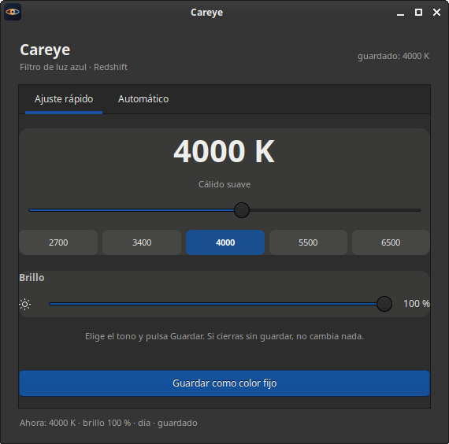
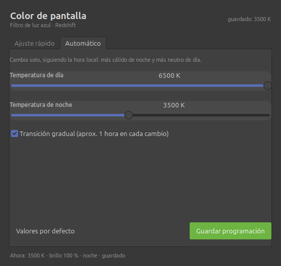

# Color de pantalla — GUI para Redshift

Ventana GTK sencilla para **elegir el tono y el brillo de la pantalla** sin editar
`redshift.conf` a mano. Pensada para Xfce/Linux Mint, pero funciona en cualquier
escritorio con X11 y GTK3.



## Qué hace

- **Ajuste rápido:** temperatura de 1000 a 6500 K con atajos (2700, 3400, 4000,
  5500, 6500), brillo del filtro de 30 a 100 % y botón para guardar un color fijo.
- **Automático:** temperatura de día y de noche, transición gradual y guardado de
  la programación para que Redshift cambie solo según la hora.
- Escribe `~/.config/redshift.conf` (guardando una copia `.bak`) y reinicia
  Redshift para aplicar el cambio.
- **Sin vistas previas en vivo a propósito:** si la ventana aplicara el color por
  su cuenta, el servicio de Redshift lo reaplicaría a los pocos segundos y la
  pantalla parpadearía entre tonos. Aquí solo se toca la pantalla al pulsar
  *Guardar*.

<p align="center">
  
</p>

## Requisitos

- Linux con **X11** (Redshift usa `randr`; en Wayland puro puede no aplicarse).
- `redshift` y `redshift-gtk` (en Debian/Ubuntu/Mint: `sudo apt install redshift redshift-gtk`).
- `python3` con **PyGObject** y GTK3 (`python3-gi`, `gir1.2-gtk-3.0`).

## Instalación

```sh
git clone https://github.com/NeriVice/redshift-color.git
cd redshift-color
./install.sh
```

El instalador copia el programa en `~/.local/bin`, el lanzador en
`~/.local/share/applications` y deja la entrada **Color de pantalla** en el menú.

Instalación manual:

```sh
install -m 755 redshift-color.py   ~/.local/bin/redshift-color
install -m 755 redshift-gtk-single ~/.local/bin/redshift-gtk-single
install -m 644 redshift-color.desktop ~/.local/share/applications/
# edita Exec= con la ruta absoluta a ~/.local/bin/redshift-color
```

## Uso

1. Abre **Color de pantalla** desde el menú (busca *color* o *redshift*).
2. Elige el tono: a la derecha (5500–6500 K) se ve más neutro/claro; a la
   izquierda (2700–3400 K) más cálido y anaranjado.
3. Ajusta el brillo si quieres atenuar el filtro.
4. Pulsa **Guardar como color fijo** (o **Guardar programación** en la pestaña
   Automático). Redshift se reinicia y mantiene el ajuste.

> Guardar tarda un segundo y la pantalla pasa brevemente por un tono neutro
> mientras Redshift se reinicia: es normal.

## Cómo funciona

La ventana lee y escribe las claves de la sección `[redshift]` de
`~/.config/redshift.conf` conservando el resto del archivo:

| Clave | Uso |
|---|---|
| `temp-day`, `temp-night` | temperatura de día y de noche |
| `brightness-day`, `brightness-night` | brillo del filtro (0.1–1.0) |
| `transition` | `1` transición gradual, `0` cambio inmediato |

Al guardar se reinicia Redshift (`pkill` + lanzador de instancia única). Antes de
arrancarlo se neutraliza la rampa con `redshift -x`; si no, al reiniciar sobre una
pantalla ya cálida el filtro se multiplica y la pantalla queda cada vez más oscura.

El script `redshift-gtk-single` evita que se lancen dos instancias de Redshift a
la vez (dos instancias aplican rampas distintas y producen parpadeos).

## Desinstalar

```sh
./uninstall.sh
```

No borra tu `~/.config/redshift.conf`.

## Problemas conocidos

- **Wayland:** Redshift necesita `randr`; en Wayland puro el ajuste puede no
  aplicarse. Usa una sesión X11 (Xfce, Mate, Cinnamon con Xorg).
- **La pantalla se ve oscura:** el brillo del panel no lo controla Redshift; usa
  las teclas de brillo. El ajuste de esta ventana solo afecta al filtro de color.
- Si algo queda raro, reinicia Redshift a mano:
  `pkill -x redshift && redshift-gtk &`

## Licencia

MIT — ver [LICENSE](LICENSE).
